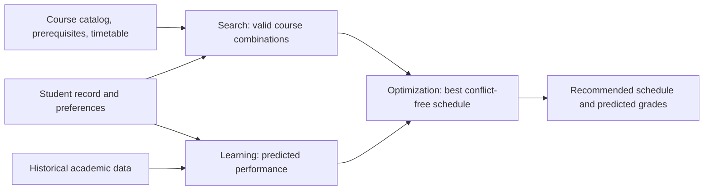

# Smart University Course Advisor

> An intelligent course-registration assistant that recommends eligible courses, builds the best
> conflict-free timetable, and predicts student performance.
> Artificial Intelligence course project (group of 10).

[Arabic explanation / الشرح بالعربي](README.ar.md)

---

## 1. Overview

Every semester a student must choose courses that (a) they are eligible to take (prerequisites),
(b) do not clash in time, (c) respect a credit-hour limit, and (d) fit their abilities and preferences.
Doing this by hand is slow and error-prone.

**Smart University Course Advisor** automates it with three AI components working together:

| Required component | What it does in this project |
|---|---|
| **Searching** | Explores valid course combinations based on prerequisites and timetable availability. |
| **Learning** | Predicts student performance from historical academic data. |
| **Optimization** | Generates the best conflict-free schedule based on credit hours, predicted performance and timetable preferences. |

**Expected outcomes:** eligible course recommendations, optimized schedules, and predicted academic performance.

## 2. How it works (pipeline)



1. **Search** filters the catalog down to courses the student may take and enumerates combinations
   that do not conflict in time.
2. **Learning** estimates how well the student is likely to do in each candidate course.
3. **Optimization** picks the best combination under the credit-hour limit and preferences, using the
   predictions as part of its objective.
4. The **app** shows the recommended schedule and the predicted performance.

> The exact algorithms (for example CSP/backtracking, a regression or classification model, a genetic
> algorithm) are decided by the team and documented in `docs/`.

## 3. Repository structure

```
smart-university-course-advisor/
├── README.md            # this file (English)
├── README.ar.md         # Arabic explanation
├── requirements.txt     # Python dependencies (the team fills this in)
├── data/                # datasets (raw / processed)
├── notebooks/           # exploration and experiments
├── src/
│   ├── data/            # loading, cleaning, (synthetic) data generation
│   ├── search/          # Searching component
│   ├── learning/        # Learning component
│   ├── optimization/    # Optimization component
│   ├── evaluation/      # baselines, metrics, experiments
│   └── app/             # user interface / demo
├── tests/               # automated tests
├── results/             # figures and result tables used in the report
├── docs/                # plan, data schema, team workflow, report, presentation
└── .github/             # pull request and issue templates
```

Each folder has its own `README.md` explaining what belongs there.

## 4. Getting started

_To be completed by the team once the code exists (environment setup, how to run each component,
how to launch the app)._

Team workflow (branches, pull requests, reviews): see [`docs/TEAM_WORKFLOW.md`](docs/TEAM_WORKFLOW.md).

## 5. Course requirements covered

- Group of 7-10 students (we are 10).
- The project contains **Searching, Learning and Optimization**.
- Deliverables on discussion day: **a working project** and **a presentation**.
- Grading (20 marks): Presentation (5), Code running + Results and conclusion + Challenges and
  proposed solutions (10 in total), Questions and discussion, individual (5).
- Bonus marks may be granted for technical complexity and creativity.

## 6. Team members

| # | Name | Role / module | Contribution notes |
|---|---|---|---|
| 1 | Ahmed Ayman | _TBD_ | _TBD_ |
| 2 | Ahmed Taha | _TBD_ | _TBD_ |
| 3 | Ebrahem Mahmoud | _TBD_ | _TBD_ |
| 4 | Oday Emad Eldin | _TBD_ | _TBD_ |
| 5 | Adham Mohamed | _TBD_ | _TBD_ |
| 6 | Hassan Ibrahim | _TBD_ | _TBD_ |
| 7 | Abdalrahman Mohamed Talaat | _TBD_ | _TBD_ |
| 8 | Mahmoud Dawood Abdelhamed | _TBD_ | _TBD_ |
| 9 | Emad Ahmoud | _TBD_ | _TBD_ |
| 10 | Zeyad Mahoud | _TBD_ | _TBD_ |

## 7. Project status

- [ ] Data schema agreed ([`docs/DATA_SCHEMA.md`](docs/DATA_SCHEMA.md))
- [ ] Data collected / generated and cleaned
- [ ] Searching component
- [ ] Learning component
- [ ] Optimization component
- [ ] Components integrated
- [ ] Evaluation and baselines
- [ ] App / demo
- [ ] Report and presentation
